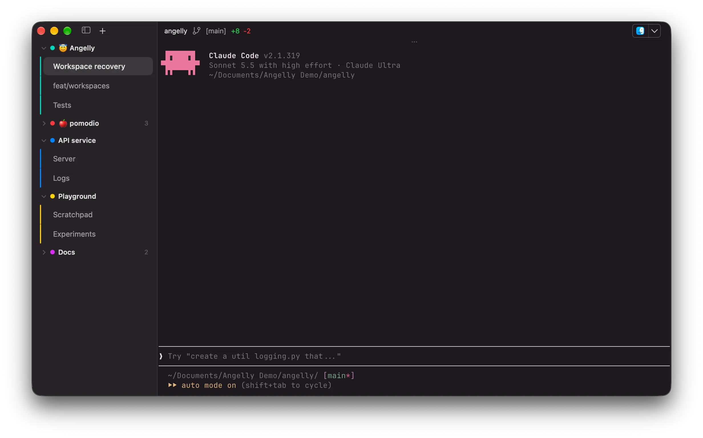

<p align="center">
  
</p>

<h1 align="center">Angelly</h1>

<p align="center">
  Your terminal, with wings.
  <br />
  A personal macOS fork of <a href="https://ghostty.org">Ghostty</a>.
</p>

Angelly is a native terminal with a Rust frontend built with GPUI and Ghostty's
Zig terminal library. The Rust workspace lives in `rust/`.

Angelly's wing and terminal prompt icon comes in ten styles: Official, Blueprint,
Chalkboard, Microchip, Glass, Holographic, Paper, Egyptian, Retro, and X-ray.
Official is the default. Choose another with `macos-icon` in your configuration
(for example, `macos-icon = blueprint`). See the [icon assets](images/BRANDING.md).

## Screenshots



## Angelly features

- ⚙️ Settings organized into clear sections.
- 🔄 Automatic update checks and downloads.
- ↔️ Resizable tab sidebar with remembered width.
- 🗂️ Tab groups with color coding.
- ➕ Choose where new tabs open.
- ♻️ Recover recently closed windows, including after restarting Angelly.
- Create, open, and safely remove Git worktrees from either tab layout.

Angelly is a personal, vibe-coded project and may have rough edges.

## Project direction

There’s no set roadmap. Angelly started as a way to add sidebar tabs and tab
groups to Ghostty. Have an idea? You’re welcome to contribute or [open an
issue](https://github.com/adetxt/angelly/issues).

The Rust app supports macOS and has Linux packaging. See
[platform support](rust/packaging/README.md) for the current platform limitations.

## Install

Download the DMG from [Releases](https://github.com/adetxt/angelly/releases)
and drag Angelly into Applications.

## Build

For macOS, install Rust, Xcode, and [Zig](https://ziglang.org/download/) 0.17.0.
Cargo builds and links `libghostty-vt` automatically.

```sh
cd rust
cargo run -p angelly
```

```sh
rust/scripts/bundle-macos.sh --debug
open rust/target/bundle/Angelly.app
```

Run the bundle commands from the repository root. Run Rust tests with
`cd rust && cargo test --workspace`, or a focused test such as
`cargo test -p terminal --test term mouse_selection_gesture`.

The root Zig build, `src/`, `include/`, `pkg/`, and `vendor/` remain dependencies
of the Rust terminal backend. `macos/Assets.xcassets` supplies the packaging icons.
The remaining upstream app code and build files are retained as reference; the
Rust app is built with Cargo. [HACKING.md](HACKING.md) describes the inherited
Ghostty code.

## Credits and license

Angelly is built on [Ghostty](https://github.com/ghostty-org/ghostty) by
Mitchell Hashimoto and the Ghostty contributors. This is an independent fork,
not affiliated with or endorsed by Ghostty or its maintainers. Ghostty and
Angelly are released under the MIT license. See [LICENSE](LICENSE).
