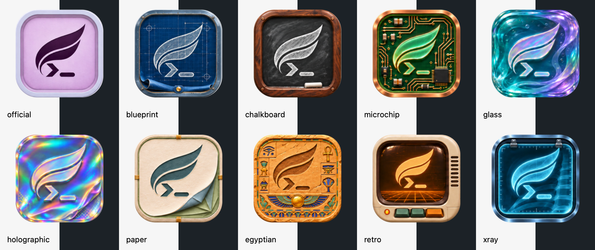

# Angelly icons

Angelly uses a wing above a terminal prompt. The lilac Official icon is the
default; the other materials are alternate treatments of the same mark from the
supplied ten-icon reference. Textures, gradients, and highlights belong to those
materials. Each icon has a transparent exterior and the same visual size.

## Asset locations

- `macos/Assets.xcassets/Angelly.appiconset/` supplies the default app icon and
  macOS/Linux Rust packaging sizes.
- `macos/Assets.xcassets/AppIconImage.imageset/` and `Alternate Icons/` contain
  the full-size Official and alternate artwork used by the macOS asset catalog
  and copied into the Rust macOS bundle.
- `rust/crates/app/assets/icons/` contains 256px copies embedded in Rust panels,
  including the About carousel and update dialogs.
- `images/icons/` and `images/gnome/` mirror Official for inherited packaging.
- `images/Angelly.icon/` contains the Icon Composer source. The custom macOS
  color compositor uses the wing mask in `CustomIconGhost.imageset`; that asset
  name is retained for compatibility.
- `dist/doxygen/favicon.png` uses the Official icon for generated documentation.
- `dist/windows/ghostty.ico` retains the inherited resource name and contains
  Official at 16, 24, 32, 48, and 256px.

When changing artwork, regenerate every size and mirror above from the full-size
asset catalog images. Keep a transparent margin of about 9% on each edge, with
the icon frame occupying about 82% of the canvas. These raster assets were
prepared from the supplied reference with the built-in imagegen tool, then
cropped, clipped to their frames, and resized for each consumer. The reference
limits their underlying texture resolution; larger PNG dimensions do not add
source detail.

The image preparation prompt requested faithful extraction of all ten designs,
preserving their wing-and-prompt silhouette, materials, colors, and order while
removing the split backgrounds and labels. No app identity or configuration keys
were renamed. Existing `macos-icon` values continue to select the same styles:
`official`, `blueprint`, `chalkboard`, `microchip`, `glass`, `holographic`, `paper`,
`egyptian`, `retro`, and `xray`.

The additional `attack-on-titan` variant appears as **Attack on Titan** in the
icon picker. It preserves Angelly's flowing two-band wing and terminal prompt,
splitting each band into three sections over a four-panel ivory and gray shield.
It uses the supplied reference's forest green, navy, ivory, and fabric treatment.
Its 1024px source is in `Alternate Icons/AttackOnTitanImage.imageset/`; the
embedded 256px copy is `rust/crates/app/assets/icons/attack-on-titan.png`.
The built-in imagegen tool generated this variant using Official as the wing
shape reference and the supplied image for colors, materials, shield, and feather
joints. The [final generation prompt](attack-on-titan-prompt.txt) preserves the
Angelly silhouette and excludes the paired Scout wings. Native CoreGraphics
resampling aligns both output sizes to the existing 82% tile footprint.

## Verification

- Hard gate PASS: the replacement adds no controls or layout changes; all asset
  catalog filenames and Icon Composer layer references resolve, and the macOS
  app builds successfully.
- Purpose gate PASS: the wing and prompt identify this terminal; each material
  treatment follows the supplied icon set. The tagline refers to the wing mark.
- Liveliness PASS: energy 2, rhythm 1, motion 1. The same wing motif, frame size,
  and transparent margin connect all ten treatments. The preview above checks
  each icon against light and dark backgrounds.
- Craftsmanship PASS: all ten embedded PNGs and 47 catalog/packaging PNGs pass
  square-size and transparent-corner assertions. Retina files use twice their
  named size. Eight About-window tests pass. The macOS bundle passes signature
  verification and contains all ten matching variant files. Linux staging
  matches the six source sizes; the Windows ICO validates at all five sizes.

Linux and Windows runtime rendering was not tested. The preview bundle is
`rust/target/branding-preview/Angelly.app`; no installed app was replaced.
